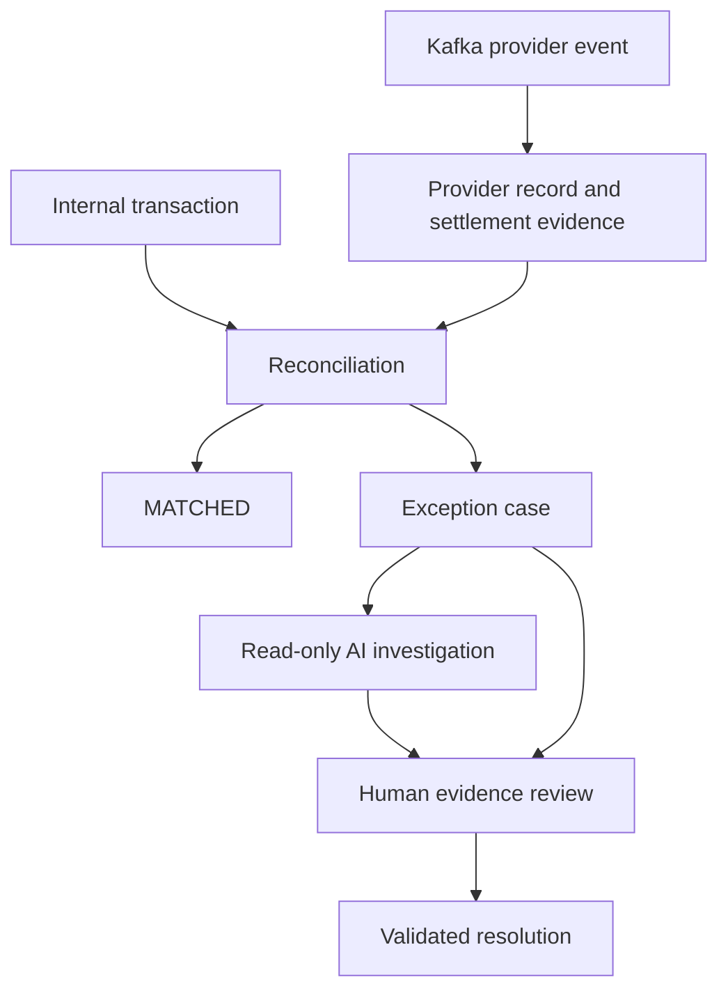

# Architecture and domain boundaries

ReconFlow compares independently owned internal and provider records, retains a
deterministic reconciliation decision, and opens a case when a human must decide
what to do. AI supplies evidence and recommendations; only an authorized human
workflow can resolve the case. No payment or refund execution exists.

## Runtime and ownership

The MVP is one Java 25 / Spring Boot application and one PostgreSQL database,
organized into Spring Modulith modules. Kafka is the external provider-delivery
boundary. PostgreSQL also holds the durable internal event-publication registry
and pgvector knowledge passages. Keycloak supplies OIDC identity. The static
analyst/admin UI is served by the same application.

| Module | Owns | Public interaction |
| --- | --- | --- |
| `transactions` | Immutable internal payments/refunds | Record/query ports; `TransactionRecorded` |
| `provider` | Normalized provider records, deduplication, settlements and fees | Kafka simulator/consumer; provider and settlement ports/events |
| `reconciliation` | Arrival windows, candidate matching, rule evaluations and discrepancies | Tenant-scoped queries; final determination events |
| `cases` | Case lifecycle, notes, investigations and human resolution | Validated commands/queries; case and investigation events |
| `ai` | Read-only orchestration, immutable documents, retrieval and judgment | Investigation engine and tenant-scoped knowledge ports |
| `tenancy` | Trusted tenant/actor and active membership roles | OIDC boundary; `CurrentTenant` / `CurrentActor` |
| `audit` | Append-only business history | Event subscriptions; tenant-scoped audit queries |
| `reporting` | Dashboard composition | Read ports over module-owned data |

Root-package coordinators compose public ports where workflows span modules.
Modules do not reach into another module's persistence classes.
`ApplicationArchitectureTest` verifies the module graph. A domain aggregate is
not a service deployment: aggregate IDs preserve ownership without a shared
object graph or a transaction encompassing the entire business workflow.

Each committed financial, decision and case event also feeds audit history.
The diagram shows business flow; internal listeners use separate transactions.

## Deterministic financial decisions

Internal and provider records remain distinct immutable sources. Provider event
identity and logical provider transaction identity both participate in ingestion
idempotency. Repeated transport delivery is not itself a duplicate financial
record; competing logical records can produce `DUPLICATE_TRANSACTION` instead.

Matching requires exact reference, equal amounts, currency and type, compatible
statuses, and an acceptable occurrence-time difference. Money uses decimal
currency precision; the browser preserves monetary JSON text. There is no
implicit amount tolerance. Reported settlement fees support a discrepancy rather
than automatically proving a valid contractual fee.

The arrival deadline is distinct from financial occurrence time. A counterpart
received before the deadline remains eligible when processing is delayed.
Absent counterparts expire to `UNMATCHED` in either direction. A transaction-scoped
PostgreSQL advisory lock serializes matching and expiry for a tenant/reference.
Database uniqueness prevents duplicate effective decisions and case opening.
See [automatic reconciliation](automatic-reconciliation.md) and
[exceptions](exception-workflow.md).

Reconciliation owns its original determination and discrepancy identities. Human
resolution changes the case, preserving `REVIEW_REQUIRED` or `UNMATCHED` history.
Cases use optimistic locking, immutable notes and a final resolution with actor,
time, reason and evidence references. Resolved cases cannot be reopened in v1.

## Delivery, failures and recovery

The provider simulator acknowledges Kafka acceptance, not completed ingestion.
Kafka retries failed deliveries before routing exhausted records to the DLT;
failed DLT publication does not acknowledge the original record. Inspect and
correct failures before replaying with the original source identity.

Internal domain events are registered with the originating database transaction.
Listeners perform their work in separate transactions. Incomplete publications
are replayed on application restart under the base configuration, independently
of the AI profile. Idempotent consumers and database constraints protect replay.
This is at-least-once processing, not a claim of distributed exactly-once delivery.
Persisted events provide recovery; there is no separate continuous internal retry
scheduler or operator replay UI in this MVP.

AI execution requires the `ai` profile on recovery. Recommendations that fail
validation or judgment retain a FAILED investigation; the analyst can request a
new attempt. Completed attempts are historical evidence. A failed advisory
attempt never approves a financial state change.

Audit appends are idempotent and database triggers reject updates/deletes/truncates
through ordinary application writes. Structured workflow logs are emitted after
audit commit. Operational traces can change across a process restart; persistent
business event/correlation/causation IDs join the history. See
[delivery](provider-delivery.md), [audit](audit-history.md) and
[observability](observability.md).

## Identity, retrieval and AI authority

OIDC verifies signature, issuer, expiry and audience. The token's tenant claim
selects an active database membership; that membership supplies the role. Tenant
headers and model-supplied IDs grant no access. Direct foreign-tenant IDs return
404 and foreign-tenant list filters return no rows. Browser login uses code/S256
PKCE and holds access tokens in memory. See [authentication](authentication-api.md).

Each investigation binds tools to one trusted tenant and case. The model can
read linked evidence and search screened tenant documents; no write tool exists.
The RAG pipeline rewrites/expands queries, applies server-created tenant/kind
filters in pgvector, rereads immutable passages, then screens and reranks them.
Citation references must exactly identify evidence supplied to that investigation.
Judgment failures withhold evidence or fail the recommendation; one bounded
refinement is allowed. See [AI investigations](ai-investigations.md) and
[retrieval](knowledge-retrieval.md).

Confidence and judge scores do not establish financial correctness. AI findings
do not fill or submit the human resolution form. The normal application role,
tenant and state checks remain authoritative.

## Deliberate MVP limits

One simulated provider, deployment-managed memberships and property-configured
rules are sufficient for this release. There is no user-provisioning UI, rule
builder, case assignment queue, automatic settlement accounting, real funds
movement, notifications, workflow engine, service extraction or Kubernetes setup.
These do not need to be added to demonstrate the agreed workflows.

The [acceptance review](acceptance.md) maps the product requirements to checks
and distinguishes tested integration behavior from pending live AI evaluation.
